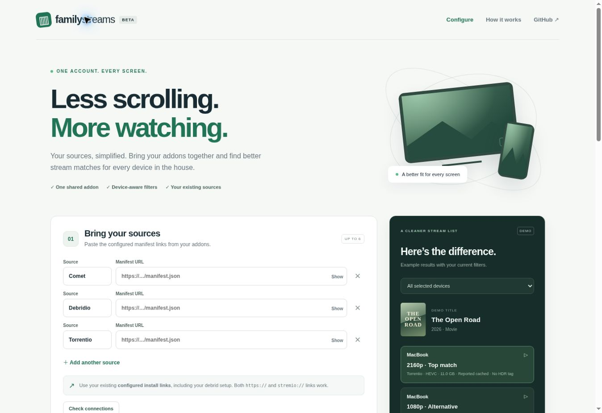

# Family Streams

One shared Stremio addon for a household using different screens. A responsive setup website generates **one encrypted `manifest.json` URL containing all selected device profiles**. There are no personal names or separate per-device installations.

The addon requests streams from your configured Comet, Debridio, Torrentio, or other Stremio stream addons, deduplicates identical playback links, filters likely incompatibilities, and returns a short ranked list. This is an independent project; it is not affiliated with Stremio or those providers.



## Deploy on Netlify

1. Import `jaxf/stremio-filter` into Netlify and select the branch containing this implementation.
2. The included `netlify.toml` sets `public` as the publish directory and `netlify/functions` as the functions directory. No build command or application dependencies are required. Use Node 22 or newer.
3. Create a secret locally with:
   ```sh
   node -e "console.log(require('node:crypto').randomBytes(32).toString('hex'))"
   ```
4. Set **`CONFIG_SECRET`** to that value in Netlify's environment variables, including the **Functions** scope. Do not commit it. Redeploy after changing environment variables.
5. Open the deployed site. Paste at least one **configured** source addon manifest URL. Empty source rows are ignored. Choose devices, check source connections, and create the install link.
6. Install the link once on the shared account. Existing source addon installations can still show their original unfiltered lists; after checking Family Streams, remove those direct installations if you want only the combined list. Keep their configured links privately for future changes.

No live service is deployed by committing this repository. `/api/health` reports whether the server has a usable key. Keep the key stable: changing it invalidates all install links.

## GitHub Pages frontend

GitHub Pages cannot execute the addon backend. Host the contents of `public/` as the static site, deploy the backend separately on Netlify (or a Node host), then enter its HTTPS origin in **Using a separately hosted backend?** before generating links. Relative assets support a project path such as `/stremio-filter/`. The resulting manifest points at the backend, not GitHub Pages. Do not publish a static JSON file and expect it to perform stream searches.

## Local development

```sh
# Node 22+; no npm install needed
export CONFIG_SECRET="$(node -e "console.log(require('node:crypto').randomBytes(32).toString('hex'))")"
npm start
# Open http://localhost:3000
npm test
```

The server does not automatically read `.env`. Use your host's environment settings, export the value in your shell, or run `node --env-file=.env server.mjs`. For TV installs, use a publicly reachable HTTPS backend; localhost on a TV refers to that TV.

## One account, three result modes

| Mode | Behavior |
| --- | --- |
| Smart device matching (default) | A distinctive native client/device user agent can select one unambiguous configured profile. Generic, browser, absent, or ambiguous headers return device-labeled groups. |
| Show every device | Always returns a short group per configured device, labeled by device name. |
| One list for everyone | Uses the intersection of all selected profiles. Works without device identification but can reduce quality and available results. |

**Stremio does not reliably report the exact model, decoder support, display, or audio chain.** Google TV and Fire TV may send the same generic Android TV user agent. The addon will not guess. There is no automatic failover on player errors, playback probing, transcoding, or subtitle-format filtering in this version.

Built-in presets cover Mac, iPhone/iPad, Apple TV, Google/Android TV, Fire TV (including 4K presets), Android mobile, Windows, Linux, Samsung, LG, browser, and a conservative unknown-device option. They are starting points, not certified support for every model. Configure resolution, video/audio formats, HDR and Dolby Vision per device. Samsung/LG and unknown Fire TV generations start conservatively. iOS and Apple TV presets assume a compatible external player; web playback needs the browser profile. No AV1, HDR, Dolby Vision, DTS or TrueHD is enabled by default. Dolby Vision profile/layer differences are not comprehensively parsed.

## Filtering behavior

- Uses filename, title, description and behavior hints to infer resolution, codec, audio, HDR/DV, file size and reported cache status. It does not inspect the media itself.
- Rejects known unsupported formats, camera/screener releases, oversized files and (by default) explicitly uncached/downloading streams.
- Incomplete metadata appears only when no complete eligible matches exist for a device. It is labeled **Details incomplete**. Strict mode hides it entirely. An absent HDR tag is not proof of SDR.
- Default limit: 3 results per device, maximum file size 20 GB. The file-size cap is not a bitrate or speed test.
- Exact URLs (including their required headers) or torrent hash/file index are deduplicated. Different provider links to the same release are retained as alternatives; no filename-based deduplication discards fallbacks.
- Preserves playback URLs, subtitles and behavior hints. Namespaces existing autoplay/binge groups per device to reduce cross-profile auto-selection.
- Streams are not fetched through this server. IP-bound provider links, provider-side IP limits, authentication, outages, rate limits and redirects can affect playback. Some addons disallow requests from hosted servers. Use source providers compatible with your hosting setup.
- Direct torrents are opt-in and excluded from browser profiles. Existing debrid setup is supplied by the upstream addon, not reimplemented here.

## Security and hosting notes

The browser sends configured source links to the backend over HTTPS. Settings are compressed to reduce install-link length, then AES-256-GCM encrypts settings into the manifest URL using `CONFIG_SECRET`; no database is needed. This hides raw upstream credentials from casual inspection but **the install URL is a bearer credential**. Anyone with it can use the configured sources, and the backend operator can decrypt it. Stremio stores and syncs the install URL. Hosting access logs may contain it: avoid public logs/analytics and do not share it publicly. The app does not store source links in localStorage or log request bodies.

Requests to upstream addons require HTTPS and port 443, reject private/reserved DNS results, pin the verified IP during TLS connection, reject redirects, and enforce time/response-size limits. Query strings and configured path prefixes are preserved. Optional `ALLOWED_ADDON_HOSTS` is a comma-separated exact-host allowlist for a controlled deployment. CORS permits Stremio clients and a separate configurator; no cookies are used.

There is a basic in-memory limit of 60 API requests per client per minute, bounded input sizes, at most 6 upstream addons and 8 device profiles. The limiter is **not distributed** across serverless instances; use host-level abuse controls before offering a large public service. There is no per-link revocation or account management. Key rotation revokes all links.

Configuration is capped at 5,200 UTF-8 bytes so encrypted links stay below approximately 7,100 characters. Long provider configs may require fewer sources. Clients/hosts can impose smaller URL limits. The setup page verifies the generated manifest before showing the install button. Legacy uncompressed links remain supported. Links do not expire automatically. To edit, use the setup page again and replace the old Family Streams installation; different settings produce a different addon identity. Recreating identical settings preserves the identity.

## Verification

`npm test` uses Node's built-in test runner and local fixtures. Tests cover shared-account selection, conservative detection, codec/HDR/audio/browser filters, metadata fallbacks, encryption/tampering, input bounds, SSRF and DNS deadlines, provider failure isolation, episode URLs, preserved playback metadata, and manifest-to-stream API integration. No debrid credentials are needed. The website's stream preview is explicitly **demo data**, not a live search.

Live provider playback and physical TV behavior require testing with actual configured source links and target devices; unit/integration tests do not certify playback.

## Project layout

- `public/`: standalone setup website, shared device presets and filtering engine.
- `lib/`: validation/encryption, safe upstream fetching and addon/API handler.
- `server.mjs`: standalone Node server.
- `netlify/functions/addon.mjs`, `netlify.toml`: Netlify adapter and routing.
- `test/`: dependency-free automated tests.

Protocol references: [Stremio addon protocol](https://stremio.github.io/stremio-addon-sdk/protocol.html), [stream objects](https://stremio.github.io/stremio-addon-sdk/api/responses/stream.html), [proxying other addons](https://stremio.github.io/stremio-addon-sdk/advanced.html), [Netlify configuration](https://docs.netlify.com/build/configure-builds/file-based-configuration/).
